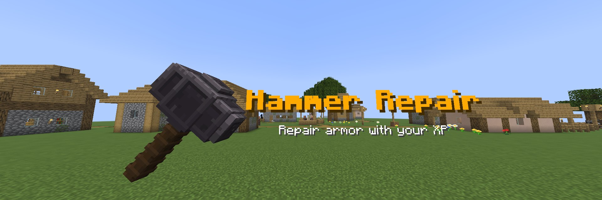
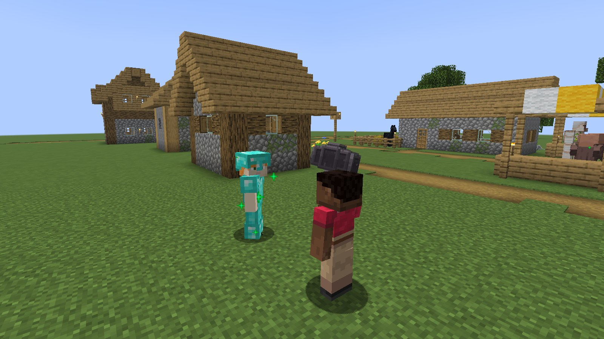
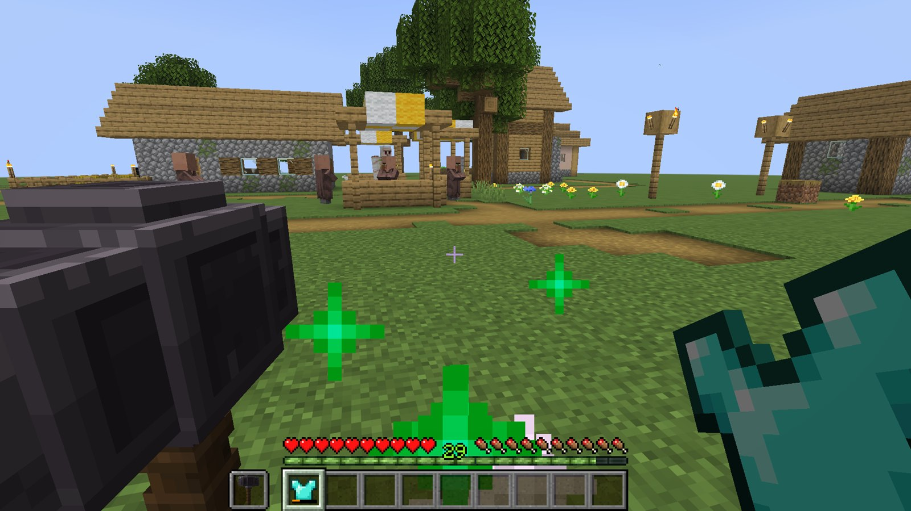
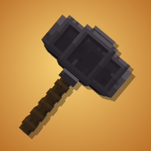
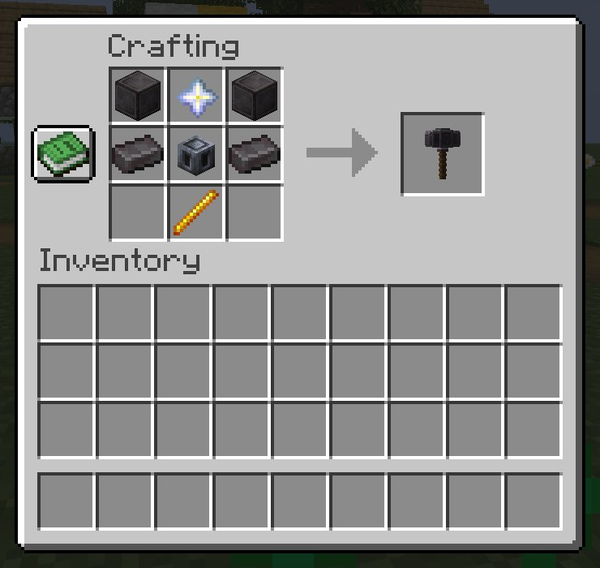
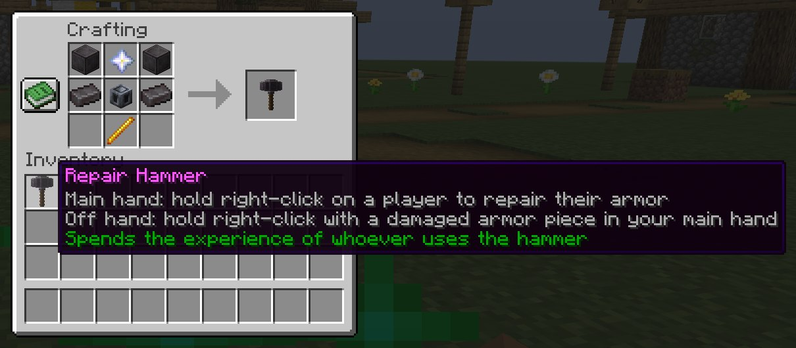

# Hammer Repair

[](https://github.com/AloneX15/hammer-repair-mod/actions/workflows/build.yml)
[](https://github.com/AloneX15/hammer-repair-mod/releases)


Adds a permanent repair hammer that mends your own or a teammate's armor by spending the user's experience points.

Un único martillo de progresión avanzada que repara armaduras gastando la experiencia de quien lo usa: útil en
cooperativo para mantener equipado a un compañero y en solitario para reparar tus propias piezas.

| Reparar a un compañero | Reparar tu propia armadura |
|---|---|
|  |  |

## El martillo



| | |
|---|---|
| **Objeto** | `hammer_repair:repair_hammer` (Martillo de reparación / Repair Hammer) |
| **Durabilidad** | Ninguna: no se desgasta ni hace falta repararlo |
| **Pila** | 1 |
| **Rareza** | Épica (nombre en morado) |
| **Fuego y lava** | Resistente, como la netherita |
| **Encantamientos** | No admite |
| **Combate** | Sin daño ni efectos extra |
| **Modo creativo** | Pestaña *Herramientas y utilidades* |
| **Modelo** | 3D, hecho en Blockbench, con textura de 128×128 |

### Cómo se usa

Se **mantiene pulsado el clic derecho**. Cada **segundo** se completa un golpe que repara **hasta 20 de durabilidad**
y cuesta **1 punto de experiencia por cada 2 de durabilidad**, siempre al jugador que usa el martillo.

| Modo | Manos | Qué repara |
|---|---|---|
| **Compañero** | Martillo en la mano principal, apuntando a otro jugador a **3 bloques** o menos, sin nada en medio | La pieza equipada con **menor porcentaje** de durabilidad (empates: casco, pechera, pantalones, botas) |
| **Propia** | Martillo en la **segunda mano**, pieza dañada en la principal | Esa pieza. Tiene prioridad sobre equiparla; sin daño, el juego se comporta como siempre |

Un ejemplo: reparar 400 de durabilidad cuesta 200 puntos de experiencia (algo más de 11 niveles si partes de 0) y lleva 20 golpes,
unos 20 segundos.

### Receta

| Receta predeterminada | Tooltip en el juego |
|---|---|
|  |  |

| | | |
|---|---|---|
| Bloque de netherita | Estrella del Nether | Bloque de netherita |
| Lingote de netherita | Núcleo pesado | Lingote de netherita |
| | Vara de blaze | |

La receta se puede cambiar o desactivar en `config/hammer_repair/recipe.json` (ver [Configuración](#configuración)).

## Características

- **Martillo de reparación** (`hammer_repair:repair_hammer`): no pierde durabilidad, no se apila, no se encanta y es
  resistente al fuego. No añade daño ni efectos de combate.
- **Reparar a un compañero:** martillo en la mano principal, apunta a otro jugador (máx. 3 bloques, con línea de
  visión) y mantén clic derecho. Cada segundo se completa un golpe que repara la pieza equipada con menor porcentaje de
  durabilidad (empates: casco, pechera, pantalones, botas).
- **Reparar tu armadura:** martillo en la segunda mano, pieza dañada en la principal y mantén clic derecho. Tiene
  prioridad sobre equipar la pieza; si la pieza no está dañada, el juego se comporta como siempre.
- **Coste en experiencia** del jugador que usa el martillo, nunca del compañero: 1 punto por cada 2 de durabilidad, como
  máximo 20 de durabilidad por golpe. Se usan puntos, no niveles, sin pérdidas por redondeo de la barra.
- Soltar el botón, cambiar de objeto, perder la línea de visión, alejarse, morir o desconectarse interrumpe la acción y
  **nunca se cobra un golpe incompleto**. Solo se cambia el daño de la pieza: encantamientos, nombre y demás componentes
  se conservan.
- En creativo se repara sin gastar experiencia; en espectador no se puede reparar.
- Golpe de brazo visible para todos al pulsar el clic derecho y en cada reparación, sonido suave de yunque, chispas y
  partículas de aldeano feliz. Avisos en la barra de acción (sin experiencia, sin armadura dañada, consentimiento,
  reparación completada) limitados para no repetirse.
- **Receta configurable** en `config/hammer_repair/recipe.json`: con forma o sin forma, objetos de Minecraft o de otros
  mods, etiquetas y alternativas. Se recarga con `/hammerrepair reload`.
- Traducciones en español e inglés.

## Instalación

1. Instala [Fabric Loader](https://fabricmc.net/use/) y [Fabric API](https://modrinth.com/mod/fabric-api).
2. Descarga el jar de tu versión de Minecraft desde [Releases](https://github.com/AloneX15/hammer-repair-mod/releases) y ponlo en `mods/`.

El mod va **en el cliente y en el servidor**. Un cliente sin el mod, o con una versión de protocolo distinta, recibe
un mensaje claro al conectar. En una partida individual basta con instalarlo en el cliente.

Build de desarrollo (último `main`, ya probado): [release `dev`](https://github.com/AloneX15/hammer-repair-mod/releases/tag/dev).

## Compatibilidad

| Minecraft | Estado |
|---|---|
| 1.21 y 1.21.1 | ✅ (soporte extendido, Java 21) |
| 26.1.x | ✅ |
| 26.2.x | ✅ |
| 26.3.x | ✅ |

Probado en la CI junto a Lithium y FerriteCore. Las armaduras de otros mods funcionan si el juego las reconoce para
casco, pechera, pantalones o botas y usan la durabilidad estándar. Las ranuras adicionales (accesorios) y los sistemas
de durabilidad propios quedan fuera de la 1.0.0. Si encuentras un conflicto con otro mod, abre un
[issue](https://github.com/AloneX15/hammer-repair-mod/issues).

## Configuración

Los archivos se generan solos la primera vez en `config/hammer_repair/`. Guía completa con todos los campos, ejemplos
y mensajes de error: [docs/configuracion.md](docs/configuracion.md).

**Quién manda:** en un servidor dedicado, sus archivos (para todos los jugadores); en una partida individual o un mundo
abierto a LAN, los de la instancia que hospeda la partida. El archivo local de un cliente conectado a un servidor no
cambia nada.

### `common.json`: parámetros de reparación

```json
{
  "schema_version": 1,
  "durability_per_xp": 2,
  "max_repair_per_hit": 20,
  "hit_interval_ticks": 20,
  "max_distance": 3.0,
  "require_target_sneaking": false
}
```

| Campo | Rango | Significado |
|---|---|---|
| `durability_per_xp` | 1–100 | Durabilidad reparada por punto de experiencia |
| `max_repair_per_hit` | 1–1000 | Máximo de durabilidad por golpe |
| `hit_interval_ticks` | 5–200 | Ticks por golpe (20 = 1 segundo) |
| `max_distance` | 1–6 | Alcance de la reparación cooperativa, en bloques |
| `require_target_sneaking` | `true`/`false` | El compañero debe agacharse para aceptar |

### `recipe.json`: receta del martillo

Cada fila de `ingredients` es una fila de la mesa de crafteo y cada elemento una casilla; `null` es un hueco. Cada
ingrediente usa exactamente una clave: `item`, `tag` o `any_of` (alternativas, de 1 a 32, sin anidar). El resultado
es siempre un martillo.

```json
{
  "schema_version": 2,
  "enabled": true,
  "type": "shaped",
  "ingredients": [
    [{ "item": "minecraft:netherite_block" }, { "item": "minecraft:nether_star" }, { "item": "minecraft:netherite_block" }],
    [{ "item": "minecraft:netherite_ingot" }, { "item": "minecraft:heavy_core" }, { "item": "minecraft:netherite_ingot" }],
    [null, { "item": "minecraft:blaze_rod" }, null]
  ]
}
```

Para aplicar los cambios sin reiniciar: `/hammerrepair reload` (operador de nivel 2 o consola; en individual, con
trucos activados, o al volver a abrir el mundo).

### Prioridad de recetas y datapacks

**datapack > receta generada desde config > valores predeterminados.** Un datapack que defina
`data/hammer_repair/recipe/repair_hammer.json` sustituye a la receta de config; `/hammerrepair reload` avisa cuando
ocurre. `enabled: false` desactiva solo la receta de config: los martillos existentes siguen funcionando y un
administrador puede añadir otra receta con un datapack.

## Solución de problemas

| Síntoma | Causa y solución |
|---|---|
| El martillo no aparece en el libro de recetas | `recipe.json` es inválido (mira el log o ejecuta `/hammerrepair reload` para ver el error), `enabled` es `false` o un datapack sustituye la receta. |
| `/hammerrepair reload` dice "Configuración rechazada" | Hay un error en algún archivo: se indica el campo, fila y columna. No se ha aplicado nada; sigue activa la última configuración válida. |
| "el objeto otro_mod:… no existe" | El mod de ese ingrediente no está instalado en el servidor. Usa `any_of` con una alternativa vanilla si quieres que funcione sin él. |
| La receta desapareció tras actualizar desde una versión de prueba | El formato antiguo con `pattern` y `key` ya no se admite: el archivo se conserva y se rechaza. Pásalo al esquema versión 2. |
| No repara a un compañero | Mira la barra de acción: sin experiencia, sin armadura dañada o, con `require_target_sneaking`, el compañero debe agacharse. Apunta a su cuerpo a 3 bloques o menos sin bloques en medio. |
| Al conectar: "This server requires Hammer Repair…" | Instala en el cliente la misma versión de Hammer Repair que el servidor. |

## Desarrollo

```bash
./gradlew :26.3:build                        # compila y ejecuta los tests unitarios
./gradlew :26.3:runGameTest                  # gametests de servidor
./gradlew :26.3:runGameTest -PcompatPack     # con Lithium y FerriteCore
./gradlew :26.3:runClientGameTest            # test de cliente con capturas (incluye servidor dedicado)
./gradlew :26.3:runClient                    # abre el juego
./gradlew :1.21.1:build :1.21.1:runGameTest  # lo mismo en 1.21.1 (sin test de cliente: esa API no existe allí)
node tools/generate-textures.js              # regenera el icono del mod (el modelo 3D del martillo viene de Blockbench)
node tools/paint-hammer-texture.js           # repinta la textura del modelo 3D y la incrusta en art/repair_hammer.bbmodel
```

Todas las versiones salen del mismo código con Stonecutter. 1.21.1 usa `build.obf.gradle.kts` (Loom con remapeo y
mappings de Mojang); el código se escribe con los nombres de 26.x y los renombres (`Identifier` ↔ `ResourceLocation`,
anotación de los gametests) los traduce Stonecutter. Las diferencias de API están en `compat/Versions.java`, y las
clases de una sola época en paquetes `modern` (26.x) o `legacy` (1.21.1).

Capturas, banner e icono (y cómo regenerarlos): [docs/capturas.md](docs/capturas.md). Descripción para Modrinth y
CurseForge: [docs/store/description.md](docs/store/description.md).

Errores corregidos y su prueba de regresión: [docs/registro-de-errores.md](docs/registro-de-errores.md). Mixins y su
motivo: [MIXINS.md](MIXINS.md).

## Licencia

[MIT](LICENSE).

---

Creado por **TakumiStudios**.
